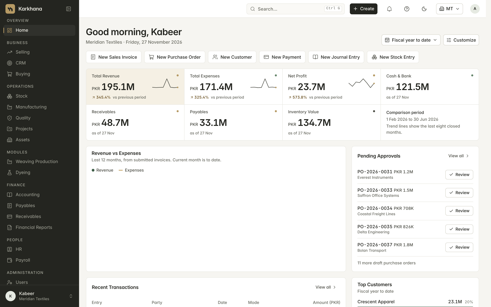

# Emadi Theme (Karkhana design)

A standalone **UI/UX redesign app for Frappe Framework v15** (works alongside ERPNext and any custom app, e.g. `emadi_v3`).
It changes how the desk looks and feels and leaves what it does alone: no DocTypes, no overrides, no server code, no changes to Frappe/ERPNext core.



## What you get

The desk now uses the **Karkhana** design language: a charcoal, cream and brass palette, Inter at 13px, 6px controls and 8px cards. Every value is copied from the Karkhana reference app.

| Area | Karkhana treatment |
| --- | --- |
| **Design tokens** | The full Karkhana palette, light and dark (`--k-bg`, `--k-surface`, `--k-ink`, `--k-line`, `--k-gold`, `--k-sage`, status colours, sidebar, charts, shadows), re-mapped onto Frappe's own variables so core and ERPNext components inherit it. |
| **Sidebar** | A 232px charcoal sidebar with grouped modules (Overview, Business, Operations, Modules, Finance, People, Administration), built from the user's permitted workspaces. Lucide icons, a gold active bar, and a user card with a menu (My Settings, Toggle theme, Log out). It collapses to a 60px icon rail, and becomes a drawer on tablet and phone. |
| **Header** | 52px white bar with breadcrumbs, a 288px search box with keyboard hint, a solid **+ Create** menu (Sales Invoice, Purchase Order, Customer, Payment, Journal Entry, Stock Entry), notifications, help, a light/dark toggle, a company button and a sage avatar. |
| **Home dashboard** | Greeting with company and date, quick-create buttons, and an 8-tile KPI grid built from ERPNext data: revenue, expenses and net profit with sparklines and change vs the previous period; cash & bank, receivables, payables and inventory value. Also a revenue-vs-expenses chart (12 months), pending approvals (draft Purchase Orders), recent transactions (Payment Entries) and top customers. |
| **Lists** | White card, 12px muted headers with no fill, 40px rows with hairline dividers, 21px status pills, solid charcoal paging. |
| **Forms** | Karkhana document layout: each section has its label in a 150px left column with fields on the right. Child-table sections run full width. Tabs are 13px with a 2px gold underline, inputs are 32px with a gold focus border. |
| **Child tables** | Bordered table with a muted header row, bordered in-cell inputs and a "+ Add row" button. Widths and scrolling are untouched. |
| **Reports** | Summary cards rendered as a stat strip, Karkhana-styled DataTable and charts. |
| **Components** | Solid charcoal primary buttons, white bordered secondary buttons, gold focus, 8px menus with shadow-2, 12px dialogs, toasts, pills, date picker. |
| **Login** | Split screen: a cream form column ("Welcome back", Work email, Password with eye toggle, "Sign in →") and a charcoal artwork panel with the brass arcs and headline. Frappe's auth flow is unchanged. |
| **Dark mode** | Karkhana's dark palette. Switch with the header moon button, the sidebar user menu, or Frappe's theme switcher. |

## Install

```bash
cd ~/frappe-bench
# Option A: from the zip
unzip emadi_theme.zip -d apps/
# Option B: from a git repo, if you push it to one
# bench get-app https://github.com/<you>/emadi_theme

bench pip install -e apps/emadi_theme      # registers the python package
echo "emadi_theme" >> sites/apps.txt        # only needed for Option A, if not already listed
bench build --app emadi_theme
bench --site <your-site> install-app emadi_theme
bench --site <your-site> clear-cache
bench restart                               # production (supervisor/nginx)
```

Then hard-refresh the browser (Ctrl+Shift+R).

### Uninstall / roll back

```bash
bench --site <your-site> uninstall-app emadi_theme
bench remove-app emadi_theme
bench build && bench --site <your-site> clear-cache
```

Nothing is stored in the database except the app's install record, so removal is clean.

> **Important:** if you previously replaced `apps/frappe/frappe/public` with the patched folder from earlier, restore the original
> (`cd apps/frappe && git checkout -- frappe/public && bench build --app frappe`). This app replaces that approach and does not need core edits.

## Build & deploy

Assets are standard Frappe v15 esbuild bundles:

| Hook (hooks.py) | Bundle |
| --- | --- |
| `app_include_css` | `public/scss/emadi_theme.bundle.scss` |
| `app_include_js` | `public/js/emadi_theme.bundle.js` |
| `web_include_css` | `public/scss/emadi_theme_web.bundle.scss` |
| `web_include_js` | `public/js/emadi_theme_web.bundle.js` |

After any change: `bench build --app emadi_theme && bench --site <site> clear-cache`.
During development: `bench watch` rebuilds on save.

## Customising

* **Product name and login copy:** `public/js/emadi_theme/brand.js` (`BRAND.NAME`, `TAGLINE`, `SUBLINE`). The logo mark is `LOGO` in `public/js/emadi_theme/lucide.js`.
* **Quick-create actions:** `QUICK_CREATE` in `brand.js`.
* **Sidebar groups and icons:** `KNOWN` (exact workspace names) and `KEYWORDS` (custom workspaces) in `public/js/emadi_theme/rail.js`.
* **Colours:** the `--k-*` values in `public/scss/_tokens.scss` (light and dark blocks).

## Files

```
emadi_theme/
├── pyproject.toml                    flit build, frappe >=15,<16
├── README.md, license.txt, .gitignore
├── docs/screenshots/*.png
└── emadi_theme/
    ├── __init__.py                   __version__
    ├── hooks.py                      asset hooks only
    ├── modules.txt, patches.txt
    ├── config/, templates/, emadi_theme/   (empty module scaffolding)
    └── public/
        ├── scss/
        │   ├── emadi_theme.bundle.scss        desk entry
        │   ├── emadi_theme_web.bundle.scss    website/login entry
        │   ├── _tokens.scss                   design tokens (light + dark) & Frappe re-map
        │   ├── desk/_base.scss                typography, focus, scrollbars, keyframes, reduced motion
        │   ├── desk/_navbar.scss              top bar, search, notifications
        │   ├── desk/_rail.scss                app rail, drawer, tooltips
        │   ├── desk/_page.scss                page head, actions, cards, skeletons, progress
        │   ├── desk/_sidebar.scss             workspace / list / form sidebars
        │   ├── desk/_components.scss          buttons, inputs, dropdowns, modals, toasts, badges, date picker…
        │   ├── desk/_workspace.scss           widgets + Karkhana Home dashboard
        │   ├── desk/_list.scss                list, filters, paging, kanban, calendar, tree
        │   ├── desk/_form.scss                tabs, sections, fields, dashboard, comments, timeline
        │   ├── desk/_grid.scss                child tables
        │   ├── desk/_report.scss              reports, summary, DataTable
        │   ├── desk/_responsive.scss          laptop / tablet / phone adaptations
        │   ├── web/_website.scss              portal & web forms
        │   └── web/_login.scss                split-screen auth
        └── js/
            ├── emadi_theme.bundle.js          desk entry (app_ready + route hooks)
            ├── emadi_theme/brand.js           product name, login copy, quick-create list
            ├── emadi_theme/rail.js            grouped Karkhana sidebar + user menu
            ├── emadi_theme/header.js          + Create menu, theme toggle, company button
            ├── emadi_theme/dashboard.js       Home dashboard (ERPNext data, read-only)
            ├── emadi_theme/lucide.js          Lucide icons + Karkhana logo mark
            └── emadi_theme_web.bundle.js      Karkhana login
```

## How it stays safe

* **No core edits, no class overrides, no monkey-patching.** JS only *adds* elements (sidebar, header controls, dashboard) and navigates with `frappe.set_route`, so permissions, route guards, keyboard shortcuts, realtime and client scripts behave as before.
* **The dashboard is inserted beside the workspace body**, never inside it, so Workspace editing/saving is untouched.
* **Dashboard data** comes from `frappe.client.get_list` with `silent: true`, so normal permissions apply. A user who can't read a doctype sees "—" for that tile and never gets an error dialog. It is read-only and cached per user for 10 minutes in sessionStorage. "Review" opens the draft Purchase Order; nothing is approved automatically.
* **Child tables:** only colours, borders and radii change. No widths, heights or scroll containers are altered, so grid.js measurements (including custom horizontal scroll) keep working.
* **CSS** is plain selectors on Frappe's documented template classes (`navbar.html`, `page.html`, `workspace.js`, list/form/grid templates), loaded after core. `!important` is used only where Frappe itself uses it.

## Testing performed

Rendered against Frappe v15's **original compiled desk/website/login CSS** and markup taken from v15 templates, with a mocked `frappe` JS API, in headless Chromium:

| Check | Result |
| --- | --- |
| SCSS compiles (Dart Sass) / JS bundles (esbuild, ES2019) | ✅ |
| Home workspace (light, dark, rail collapsed & expanded) | ✅ |
| List view with selection, pills, paging (1440 / 1280 / 390px) | ✅ |
| Form with tabs, sections, read-only & required fields, child table, comments/timeline (1440 / 820px, light & dark) | ✅ |
| Modal dialog over form (light & dark) | ✅ (fixed a z-index bug during testing) |
| Login split-screen | ✅ |
| Browser console errors from theme code | none |

**Not yet verified on a live site** (please check after install): the Home dashboard's ERPNext queries and chart against real data, saving/submitting/cancelling documents, link-field autocomplete, filter popovers, query reports with real data, print view, workspace edit mode, and every ERPNext/custom page. If something looks off, it's almost always a selector that needs a small tweak in one partial.

## Known limitations

* The rail lists **top-level** workspaces; child workspaces remain in Frappe's in-page workspace sidebar.
* KPIs on Home are generic (To-Dos, notifications, events). Business KPIs such as sales and production belong in Frappe **Number Cards** on the workspace, which this theme styles as KPI tiles.
* Pages with heavily custom HTML (custom Pages, third-party apps) inherit tokens/components but aren't individually designed.
* Print formats are intentionally untouched.
* `:has()` (selected-row highlight) needs a modern browser (Chrome/Edge 105+, Safari 15.4+, Firefox 121+); older browsers simply skip the highlight.
* RTL languages: layout works, but the rail stays on the left.
